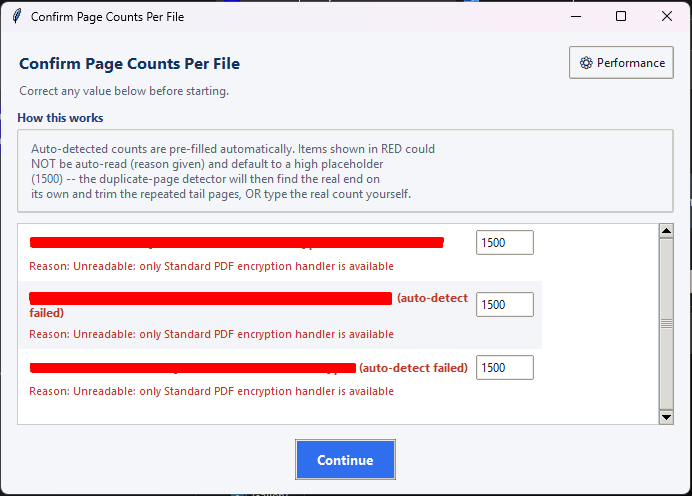
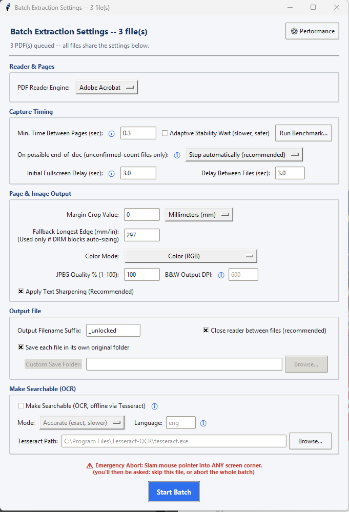
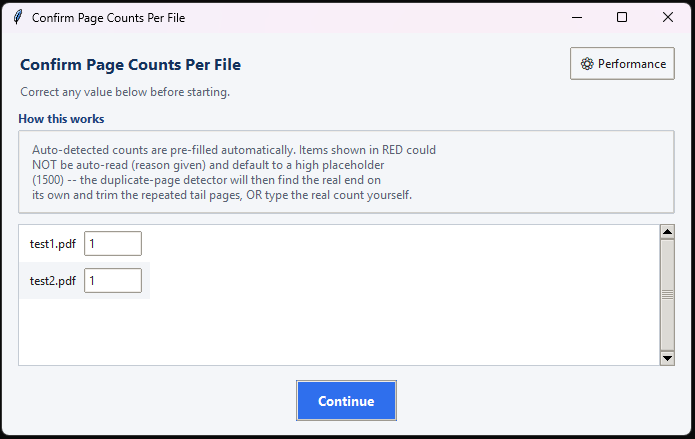
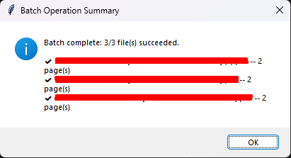

# PDF Screen Capture & Archival Tool

[](https://github.com/DatDancingBear/PDF-Screen-Capture-Tool/releases)

A Windows desktop utility that archives paginated documents rendered on-screen by a PDF
reader into a new, standalone PDF -- with optional OCR, image cleanup, and batch
processing across multiple files.

It works by driving your PDF reader through fullscreen page-by-page navigation,
screenshotting each rendered page, auto-cropping margins, and reassembling the captured
pages into a single output file. It supports single files and multi-file batch queues
via drag-and-drop.

---
## Screenshots


|---|---|
|  | |


|---|---|
|  |  |
---

## ⚠️ Disclaimer

This tool captures the on-screen rendering of a document that has **already been
legitimately opened in an authorized PDF reader on your own machine.** It does not
decrypt, crack, or attack any encryption, license server, or DRM system.

This tool is provided for legitimate purposes only, including (but not limited to):
personal archival of documents you are authorized to access, creating searchable/
accessible versions of your own scanned material, and general document digitization
workflows.

**Copying or redistributing licensed, copyright-protected, or DRM-encrypted documents
without authorization from the rights holder is strictly prohibited** in most
jurisdictions. The creator of this software does not condone, support, or take any
responsibility for such use. **Each user is 100% individually liable for how they use
this program and for ensuring their use complies with applicable copyright law and the
terms of any document or software license they are subject to.** By using this tool,
you agree you are solely responsible for your own actions.

---

## Requirements

- **Windows 10/11** (uses Windows-specific APIs -- not cross-platform)
- **Python 3.9+**
- A PDF reader installed: Adobe Acrobat/Reader, Foxit Reader, Bluebeam Revu, or
  PDF-XChange
- *(Optional, for OCR/searchable output)*: [Tesseract OCR](https://github.com/UB-Mannheim/tesseract/wiki)
  installed separately (it's a standalone program, not a Python package)

### Python packages

```
pip install pyautogui psutil pillow pypdf pytesseract
```

`pytesseract` is only required if you intend to use the OCR feature -- the program
detects its absence and simply disables that option if missing.

---

## Installation

1. Save `pdf_capture_tool_unified.py` somewhere permanent on your machine.
2. Edit the included `run_batch_capture.bat` so its path points to that location:
   ```bat
   @echo off
   python "C:\PATH\TO\pdf_capture_tool_unified.py" %*
   ```
3. (Optional) Create a desktop shortcut to the `.bat` file for easy drag-and-drop access.

---

## Usage

1. Drag one PDF (single-file mode) or multiple PDFs at once (batch mode) onto the
   `.bat` file / shortcut.
2. The first file opens automatically in your default PDF reader.
3. A **Page Count Review** step appears first (see below), followed by the
   **Settings dialog** -- configure your options once, they apply to the whole run.
4. Click **Start Extraction**. The program takes over your mouse/keyboard and the
   reader window -- **do not use the PC for anything else while it runs.**
5. When finished, a summary dialog appears and the output folder opens automatically.

### Emergency abort

**Slam your mouse pointer into any screen corner at any time** to trigger PyAutoGUI's
fail-safe and immediately stop the capture. The program will safely exit fullscreen and
ask whether to save what's been captured so far (single-file) or whether to skip the
current file or abort the whole batch (batch mode).

---

## How It Works (Pipeline Overview)

1. **Launch & detect** -- opens the dropped PDF with the OS default reader, then polls
   running processes to detect which supported reader engine is active.
2. **Page count detection** -- reads the real page count directly from the PDF
   structure via `pypdf`. If that fails (e.g. a genuine open-password, or malformed
   structure), the file is flagged with a stated reason and a high placeholder count is
   used instead, relying on automatic end-of-document detection (see below).
3. **Settings dialog** -- one-time configuration for timing, cropping, color mode,
   output format, and OCR.
4. **(Optional) Benchmark** -- automatically times a few real page turns to recommend a
   safe "time between pages" value for your specific PC/reader/document combination.
5. **Fullscreen navigation** -- brings the reader to focus, enters fullscreen using the
   correct keybinds for the detected reader engine, and pages through the target page
   range.
6. **Capture & process per page** -- screenshots the screen, auto-detects and crops the
   page's margins, applies sharpening/grayscale/pure black & white processing as
   configured.
7. **End-of-document safety nets** -- detects a genuine blank/black screen (real end of
   document) or 5 identical consecutive pages (likely padding/reached-the-end) and
   automatically trims trailing duplicate pages before saving.
8. **(Optional) OCR pass** -- runs each captured page image through Tesseract to embed
   an invisible, searchable/selectable text layer behind the image.
9. **Save & report** -- writes the final PDF, exits fullscreen, and opens the output
   folder. Batch runs additionally show a per-file success/failure summary.

---

## Settings Reference

### Reader & Pages
| Setting | Description |
|---|---|
| **PDF Reader Engine** | Which reader's keyboard shortcuts to use for fullscreen/navigation. Auto-detected from running processes, but editable if detection guesses wrong. |
| **Total Document Pages** | Confirmed/corrected per file in the Page Count Review step (see below). |
| **Pages to Capture** *(single-file only)* | A specific range, e.g. `1-5, 8`. Disabled when "Capture All" is checked. Not available in batch mode, since files have differing lengths. |

### Capture Timing
| Setting | Description |
|---|---|
| **Min. Time Between Pages (sec)** | Base delay after each page turn before capturing. Too low risks blurry/duplicate/blank pages if your reader can't keep up; too high just wastes time. A one-time ⚠️ warning appears for very low or very high values. |
| **Adaptive Stability Wait** | When enabled, the program polls the screen and waits until it visibly stops changing before capturing, instead of trusting a fixed delay. Safer on slow machines or heavy documents, at the cost of extra time per page. Off by default to preserve maximum speed on fast setups. |
| **Run Benchmark...** | Automatically turns a few real pages and measures actual render-settle time, then pre-fills a recommended "Min. Time Between Pages" value for this specific document/PC. |
| **On possible end-of-doc** *(unconfirmed-count files only)* | Controls behavior when 5 identical pages are captured in a row — only relevant for files whose page count could not be auto-confirmed. **Stop automatically** (default, trims the duplicates and moves on unattended), **Ask me each time** (pauses for your input), or **Ignore** (disables the check, for documents with legitimately long runs of near-identical pages). |
| **Initial Fullscreen Delay (sec)** | Pause after entering fullscreen before the first capture, giving your cursor time to auto-hide. |
| **Delay Between Files** *(batch only)* | Pause between finishing one file and opening the next. |

### Page & Image Output
| Setting | Description |
|---|---|
| **Margin Crop Value** | How much border to trim from each captured page, in Pixels, Millimeters, or Inches. Default is 0 (no crop). |
| **Fallback Longest Edge** | Used only if the real page dimensions can't be read from the PDF (e.g. DRM blocking metadata access) -- lets margin cropping still scale correctly. |
| **Color Mode** | **Color (RGB)**, **Grayscale**, or **Pure Black & White (Lossless)** -- the latter upscales and thresholds the image to a true 1-bit black/white output, ideal for text-only documents. |
| **JPEG Quality %** | Compression quality for Color/Grayscale output. Disabled in Pure B&W mode (which is lossless by nature). |
| **B&W Output DPI** | Target resolution for Pure B&W mode. Default 600. Note: this upscales a screenshot -- it does not re-render the PDF at higher resolution, so values much above ~900 mostly cost time/file size without adding real detail. Setting it to 96 skips upscaling entirely (fastest, but roughest edges). |
| **Apply Text Sharpening** | Applies a sharpening filter to Color/Grayscale captures -- recommended for text-heavy documents. |

### Output File
| Setting | Description |
|---|---|
| **Output Filename** *(single-file)* / **Output Filename Suffix** *(batch)* | Exact name for a single file, or a suffix appended to each original filename in batch mode. |
| **Save in original folder** | Default on -- saves next to the source PDF. Uncheck to choose one custom folder (batch: used for all files; single: used for that file). |
| **Close reader between files** *(batch only)* | Gracefully closes the reader after each file (recommended) so the next file opens cleanly without a "document not closed properly" recovery prompt. |

### Make Searchable (OCR)
| Setting | Description |
|---|---|
| **Make Searchable (OCR)** | Runs each captured page through Tesseract OCR after capture, embedding an invisible selectable/searchable text layer behind the image. Automatically disabled if Tesseract/pytesseract isn't installed. |
| **Mode: Accurate / Fast** | **Accurate** uses Tesseract's neural (LSTM) engine -- slower, higher accuracy. **Fast** uses the legacy engine -- quicker, lower accuracy. Neither produces a guaranteed 100% verbatim transcript; always spot-check OCR'd text for important documents. |
| **Language** | Tesseract language code(s), e.g. `eng`, or `eng+fra` for multi-language documents. |
| **Tesseract Path** | Location of the installed `tesseract.exe` binary. |

### Performance (⚙ gear icon)
Controls three internal wait points (fullscreen transition, page-jump dialog readiness,
home-key settle) that are otherwise invisible fixed delays:

| Mode | Behavior |
|---|---|
| **Fast PC (default)** | Original fixed, short delays. No change from default behavior. |
| **Slow PC (safe)** | Same fixed-delay approach, scaled up for slower machines. |
| **Adaptive (smart wait)** | Polls the screen and waits for visible stability at each transition point, instead of a fixed guess. Most robust, slightly slower. |
| **Manual (advanced)** | Set all three delay values yourself. |

---

## Page Count Review Dialog

Appears before the main settings dialog. For every queued file:
- Shows the **auto-detected page count**, read directly from the PDF structure.
- If detection fails, the file is shown in **red** with a plain-English reason
  (e.g. *"Password-protected,"* *"Corrupted or non-standard PDF structure,"* or the raw
  error message) and defaults to a high placeholder (1500 pages) -- the end-of-document
  safety nets described above then find the real end automatically.
- Any value can be manually corrected before proceeding, which also disables the
  duplicate-page safety net for that file (since the true count is now known).

---

## Running Without Python (Standalone .exe)

If you'd rather not install Python/pip at all, you can build a single-file, double-click
executable using [PyInstaller](https://pyinstaller.org/). This does **not** change the
open-source nature of the project — the full source remains in this repository either
way, and the `.exe` is just a convenience build anyone can reproduce themselves.

### Building it yourself

```
pip install pyautogui psutil pillow pypdf pytesseract pyinstaller
```

Then from the folder containing `pdf_capture_tool_unified.py`, either use the provided
`.spec` file (recommended -- keeps build settings consistent and repeatable):

```
pyinstaller build_config.spec
```

...or run PyInstaller directly with equivalent flags:

```
pyinstaller --onedir --windowed --name "PDFCaptureTool" --icon=app.ico pdf_capture_tool_unified.py
```

The finished program appears in `dist/PDFCaptureTool/` — drag your PDFs onto
`PDFCaptureTool.exe` inside that folder exactly as you would onto the `.bat` file. You
can create a desktop shortcut to that `.exe` for one-click/drag-and-drop use with no
terminal, no `pip install`, and no need to edit a `.bat` file's path.

**Why `--onedir` instead of `--onefile`:** `--onefile` is slightly more convenient (a
single file instead of a folder) but works by silently unpacking itself into a temp
directory every time it runs -- a behavior pattern that triggers antivirus heuristics
considerably more often. `--onedir` produces a folder instead, with no runtime
self-extraction step, and is noticeably less likely to be flagged. See below.

### ⚠️ A note on antivirus / Windows SmartScreen warnings

**You may see your antivirus software or Windows SmartScreen flag the built `.exe` as
suspicious. This is an expected false positive, not a sign anything is wrong with the
code.** Two independent, well-documented reasons this happens with tools like this one:

1. **PyInstaller-built executables are flagged more often in general.** Bundling a full
   Python interpreter and dependencies into a self-contained executable is a packing
   pattern that overlaps with how some real malware obfuscates its payload -- this is a
   long-standing, widely reported false-positive pattern across the Python packaging
   community, unrelated to what any specific bundled script actually does.
2. **This program's own functionality looks suspicious in isolation.** It simulates
   keyboard/mouse input, takes continuous screenshots, inspects the names of other
   running processes, and (if OCR is enabled) launches an external executable -- each a
   legitimate part of how it works, but also a textbook pattern for keylogger/RAT
   heuristic detection when a security scanner has no way to know *why* a program is
   doing those things.

**If you want to verify the program is safe without just trusting a stranger's binary:**
read the full source code in this repository (it's a single, non-obfuscated Python
file), or better yet, build the `.exe` yourself from that source using the steps above
so you know exactly what went into it. If your antivirus quarantines or deletes the
build, you'll need to restore it from quarantine and add a manual exclusion for the
output folder.

---

## Known Limitations

- **Not headless / not background-capable.** This is screen/keyboard automation — the
  reader window must be visibly on-screen and in fullscreen throughout, and the PC
  cannot be used for anything else mid-run.
- **Timing-sensitive.** Even with Adaptive Stability Wait, an extremely slow machine or
  very heavy page content (large embedded images, dense vector diagrams) can still
  occasionally produce a sub-optimal capture. Spot-check important output documents.
  **DPI tool anti-aliasing.** Pure B&W mode is an upscale-then-threshold of a screen
  capture, not a true high-resolution re-render — there's a practical ceiling to how
  much detail increasing DPI actually recovers.
- **OCR accuracy is not guaranteed exact**, particularly on dense tables, unusual
  fonts, or sub-optimal scan quality. Always verify OCR'd text for anything important.
- **Windows only.** Relies on `ctypes`/`win32`-style window and focus APIs throughout.

---

## License

See `LICENSE`.
